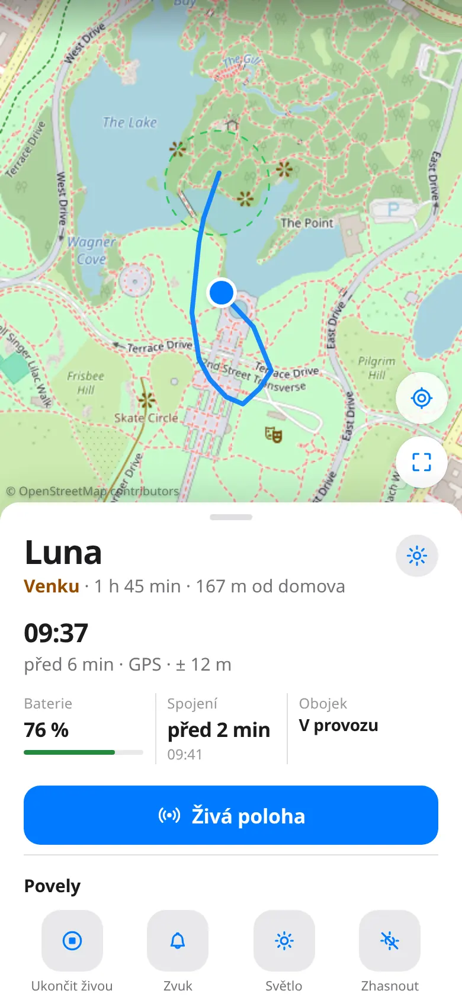
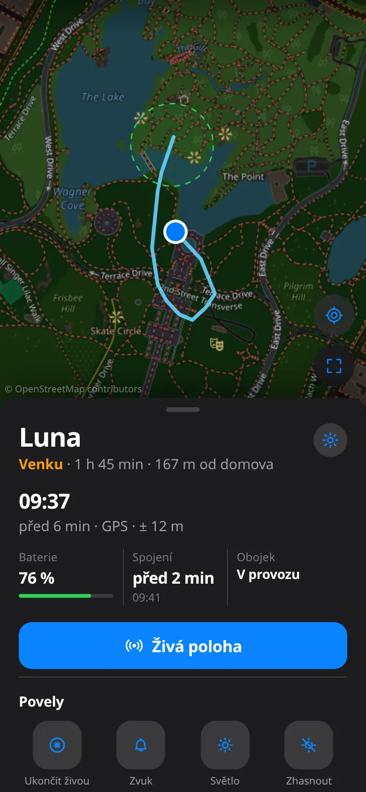
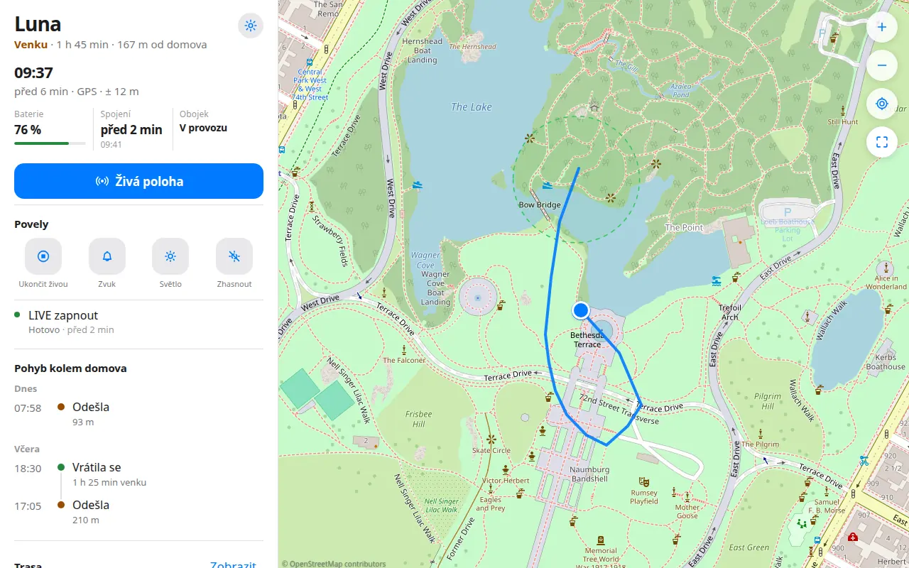
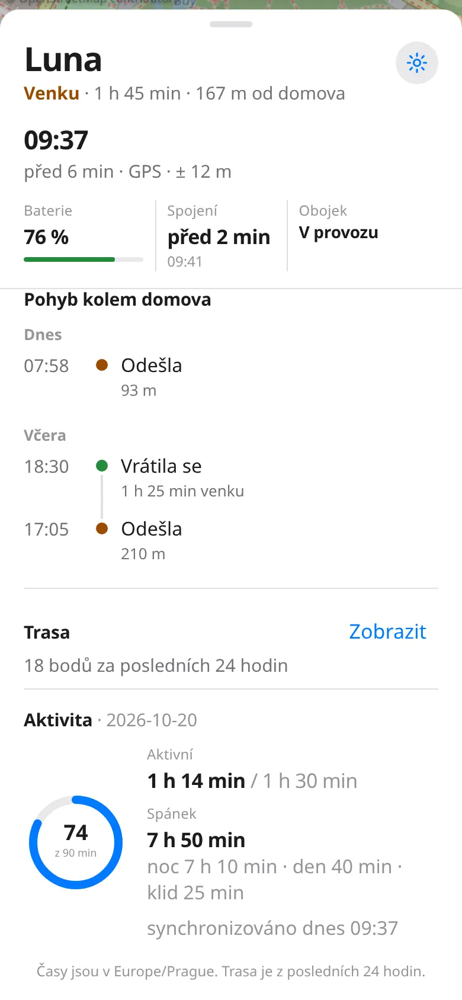
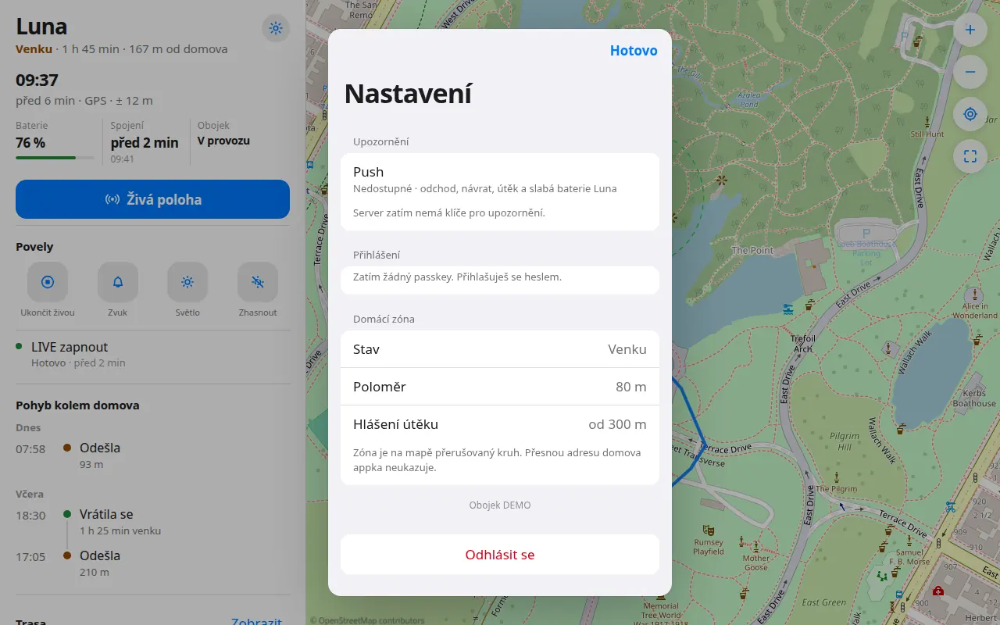
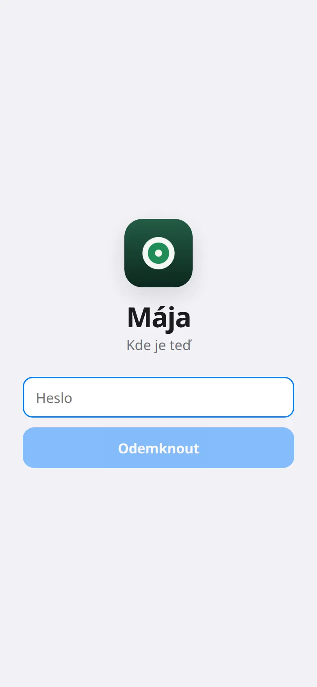

# Mája

Self-hosted dashboard for one [Tractive](https://tractive.com) GPS collar.
A single Python process logs into Tractive, stores positions in Postgres/PostGIS,
and serves a small web app (map, battery, activity, live tracking, buzzer, light,
home/away alerts, passphrase and passkey login).

The phone never talks to Tractive. It talks to your server.

## Quick start

Step-by-step (env vars, demo data, logs, backups, your own domain):
**[Run it locally](docs/getting-started.md)** · **[Spusť to lokálně (česky)](docs/getting-started.cs.md)**

```bash
git clone https://github.com/martinp0/maja
cd maja
cp .env.example .env && chmod 600 .env
# Edit TRACTIVE_EMAIL, TRACTIVE_PASSWORD, and POSTGRES_PASSWORD.
docker compose up -d --build
docker compose run --rm ingestor init-db
```

Open <http://localhost:8090>. The first build compiles the web app inside Docker; you do not run `npm` yourself.

The sample Tractive password in `.env.example` is fake. The site still opens, and the ingestor will keep failing login until you put in a real email and password (or turn on demo mode). With no collar yet, set `DEMO_MODE=1` and run `docker compose run --rm ingestor seed-demo`. That inserts a fictional dog, Luna, on a walk in Central Park.

## Screenshots

These are that demo, captured locally. The dog's name is Luna. The track is around Bethesda Fountain in Central Park, New York — a public park, not a home, and not data from a Tractive account.













## Unofficial

Mája is an independent project by Martin Pohl. It is **not** affiliated with,
endorsed by, or supported by Tractive GmbH.

It uses Tractive's private API through [aiotractive](https://github.com/jkraml/aiotractive).
That use may conflict with Tractive's terms of service. The API can change or
be shut off at any time. You use it at your own risk, for your own account.
Do not commit the location history it stores.

## What is in this repository

| Path | What |
|---|---|
| `src/tractive_ingestor` | The only Tractive client: login, backfill, realtime channel, commands, geofence, Web Push |
| `src/tractive_api` + `web/` | Read API and the Mája PWA, one container |
| `docker-compose.yml` | Postgres/PostGIS + ingestor + API, aimed at a Raspberry Pi |
| `deploy/` | Docker and systemd notes for a Pi |
| `docs/getting-started.md` | Run it on your own computer |

Deeper operator notes (Czech): [docs/operations.md](docs/operations.md).

## Self-hosting

Follow **[docs/getting-started.md](docs/getting-started.md)** (or the [Czech version](docs/getting-started.cs.md)). Short version:

```bash
git clone https://github.com/martinp0/maja
cd maja
cp .env.example .env && chmod 600 .env
docker compose up -d --build
docker compose run --rm ingestor init-db
```

`docker compose up -d --build` builds the API image and the web app. You do not need a separate `web/dist` for a normal computer.

The app listens on `127.0.0.1:8090` unless you set `API_PUBLISH_ADDR` in `.env`.
Do not publish it on `0.0.0.0` unless a login passphrase is set. A Tailscale
address (`100.x.y.z` from `tailscale ip -4` on that machine) is a reasonable
bind address. Keep that address in `.env`, not in git.

On a small Pi the web build can run out of memory. Build `web/dist` elsewhere,
copy it next to the compose file, and uncomment `additional_contexts` under
the `api` service in `docker-compose.yml`:

```yaml
additional_contexts:
  webdist: ./web/dist
```

That hook is part of the supported deploy. Leave it in place.

### Without Docker

```bash
python3 -m venv .venv && source .venv/bin/activate
pip install -e '.[api]'
cp .env.example .env   # then edit
python -m tractive_ingestor init-db
python -m tractive_ingestor
(cd web && npm ci && npm run build)
python -m tractive_api          # http://127.0.0.1:8090/
```

## Configuration

All secrets live in `.env` (gitignored). `.env.example` lists every variable
with placeholders.

| Variable | Purpose |
|---|---|
| `TRACTIVE_EMAIL`, `TRACTIVE_PASSWORD` | Tractive login. Use a password that exists only for this account. |
| `POSTGRES_PASSWORD` | Local database password. Avoid `@ : / ? #` (it is placed in a URL). |
| `APP_PIN` | Passphrase for the web app. Empty means no login (local development only). |
| `APP_SESSION_SECRET` | Cookie signing key. `openssl rand -hex 32`. |
| `HOME_LAT`, `HOME_LON` | Home geofence. Empty disables it. Never commit these. |
| `VAPID_PUBLIC_KEY`, `VAPID_PRIVATE_KEY`, `VAPID_SUBJECT` | Web Push. Generate with `docker compose run --rm --no-deps ingestor gen-vapid`. |
| `WEBAUTHN_RP_ID`, `WEBAUTHN_ORIGIN` | Passkey host. Default `localhost` and `http://localhost:8090`. On your own domain set both to that exact site. |
| `DEMO_MODE` | `1` skips the Tractive login so you can look at `seed-demo` data. Leave unset for a real collar. |
| `API_PUBLISH_ADDR` | Host address for port 8090. Default `127.0.0.1`. |
| `API_READ_TOKENS` | Optional, comma-separated read-only tokens (≥ 32 chars, `openssl rand -hex 32`) for the native iPhone/Watch app in `apple/`. GET-only on location, battery and home state. Empty = off. |

`VAPID_SUBJECT` defaults to `mailto:you@example.com` when unset. Set a real
`mailto:` in `.env` before you rely on push.

## Map tiles

The map uses the public OpenStreetMap tile server
(`https://tile.openstreetmap.org`) and shows
[© OpenStreetMap contributors](https://www.openstreetmap.org/copyright).
No tile API key is required.

Those tiles are for light, personal use under the
[OSM tile usage policy](https://operations.osmfoundation.org/policies/tiles/).
A busy public site needs its own tile server or a provider with a plan that
allows the traffic. OpenStreetMap data is licensed under the
[ODbL](https://opendatacommons.org/licenses/odbl/). This repository does not
redistribute tiles. Fonts are the visitor's system fonts. Icons in the app
are original SVG.

## Development

```bash
python -m unittest discover -s tests -v
```

API tests need `pip install -e '.[dev]'`. See [CONTRIBUTING.md](CONTRIBUTING.md).

## Security

[SECURITY.md](SECURITY.md) says how to report a problem. Do not file issues
that contain passwords or locations.

## License

Source code is [MIT](LICENSE), copyright Martin Pohl, 2026.
Map data, dependencies, and the PostGIS image keep their own licenses.
See [THIRD_PARTY_NOTICES.md](THIRD_PARTY_NOTICES.md).
